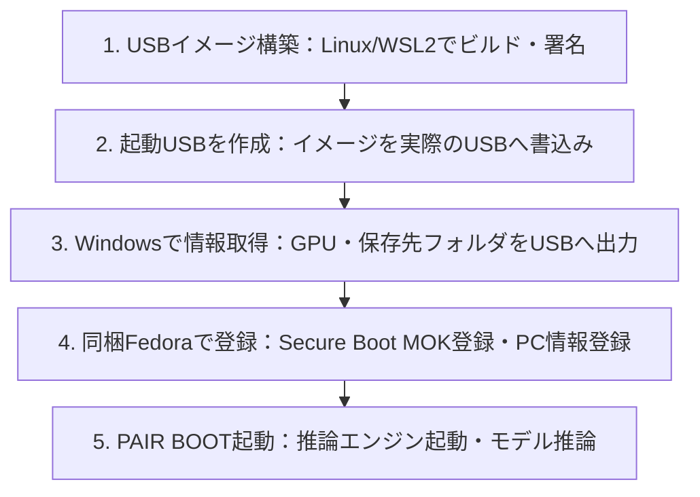

# pair-boot-usb

PCに内蔵されたNVIDIA GPUを活用し、USBから起動してLLM推論環境（PAIR）を動かすためのブータブルUSB構築ツールです。既存のWindows環境を壊さず、USBと指定した保存先フォルダのみを利用して安全に推論ノードを立ち上げられます。

RTX 30シリーズのうち対応GPUでは、gpu-unlockによる高速化（Unlock起動）も選択できます。

---

## 全体の流れ

本システムを利用する大まかな流れは以下のとおりです。

### 署名鍵の作成・管理について（重要）
PAIR BOOTでは Secure Boot の利用が前提となっています。Secure Boot を利用するには、モジュール署名に使う秘密鍵およびMOK登録に使う公開鍵（証明書）のペアを用意する必要があります。これらの作成は、**利用するPCの管理者（あるいは管理者の許諾の元で利用者）が作成**してください。秘密鍵はUSBやリポジトリに含めず、安全な保管場所で**適切に管理**してください（公開鍵のみをUSBへ配置します）。

---

## ドキュメント一覧

### 初めて利用する方へ
1. [構築環境と外部資料の準備](docs/build.md)：Linux/WSL2環境の準備とUSBイメージのビルド手順
2. [署名鍵とSecure Boot](docs/secure-boot.md)：鍵ペアの作成、モジュール署名、秘密鍵の管理方針
3. [USBの利用開始（クイックスタート）](docs/quick-start.md)：Windowsでの情報取得、FedoraでのMOK・PC登録、PAIR BOOTの起動手順

### 運用・連携
- [運用・モデル・終了・回復](docs/user-guide.md)：モデルの配置方法、正常終了・USB取り外し手順、トラブル対応
- [Windowsでの台帳管理](docs/windows-fleet.md)：複数台のPC登録情報を1台のWindowsでまとめる手順
- [開発ツールからPAIRを利用する準備](docs/pair-client-setup.md)：[VS Code](docs/vscode-pair-parallel-quick-start.md)／[OpenCode](docs/opencode-pair-parallel-quick-start.md)から推論ノードを利用する設定

動作確認の状況と残りの確認項目は [TODO](TODO.md) にまとめています。

---

## 構築要件

- **OS**: x86_64 Linux または WSL2（Ubuntu 22.04等）
- **Python**: 3.11以上（Conda用環境定義: [environment.yml](environment.yml)）
- **ストレージ空き容量**: 64GiB以上

※ 詳しい環境構築とツールの導入手順は [docs/build.md](docs/build.md#1-環境を用意する) を参照してください。

## リポジトリ構成

- `toolkit/`、`gui/`：Windows用情報取得ツールおよびFedora用管理GUI
- `runtime/`：ブート後の初期化、保存先の検証、PAIR起動と終了処理
- `scripts/`：依存パッケージ取得、カーネルモジュール構築・署名、USBイメージ組立
- `inputs/`：外部ソースの取得元URLやハッシュ値定義
- `config/`：GPU種別ごとの起動プロファイル定義
- `tests/`：実機への書き込みを行わずに動作を確認するテストスイート

## 対応範囲

- **対象GPU**: 主にRTX 30シリーズ（機種ごとにNormal／Unlockの可否が異なります）。
- **保存先**: 対象PC上の指定されたNTFS領域（既定: `GPU-Linux` フォルダ）。Windows側のデータ領域を破壊しないよう、安全性確認を行ってから利用します。

## 含まないもの

ISO本体、完成済みUSBイメージ、上流バイナリ一式、プロプライエタリドライバ、モデルデータ、署名鍵・証明書、実機のPC登録データ等は本リポジトリに含まれません。ビルドスクリプトにより各自の環境で取得・生成します。

## ライセンス

本リポジトリの独自ソース、設定、テスト、文書は [MIT License](LICENSE) で公開します。
取得・利用する外部ソフトウェアのライセンスについては [THIRD-PARTY.md](THIRD-PARTY.md) を参照してください。
