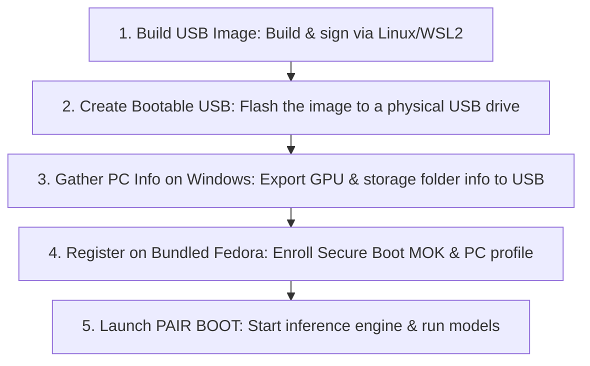

# pair-boot-usb

[日本語 (Japanese)](README.ja.md)

A build tool for creating a **USB-bootable Linux environment optimized for LLM inference ([PAIR: Personal AI Router](https://github.com/NVIDIA/Personal-AI-Router))**, leveraging the power of local NVIDIA GPUs.

This tool allows you to safely spin up a dedicated inference node using only the USB drive and a designated storage folder, **without destroying or altering your existing Windows environment**.

For supported GPUs (primarily the RTX 30 series), it also features an "Unlock Boot" option utilizing `gpu-unlock` for enhanced performance acceleration.

## Workflow Overview

The general workflow for utilizing this system is as follows:

### ⚠️ Important: Creation and Management of Signing Keys
PAIR BOOT requires **Secure Boot to be enabled**. To support this, you must prepare a key pair: a private key for module signing and a public key (certificate) for MOK (Machine Owner Key) enrollment.

These keys **must be generated by the administrator of the target PC** (or by the user with the administrator's explicit permission). For security compliance, **never include the private key in the repository or on the USB drive**. Keep it in a secure location and place only the public key on the USB drive.

---

## Documentation Index

### For First-Time Users
English versions are linked where available. Links marked (Japanese) lead to Japanese-only documents.

1. **[Environment Setup & External Resources](docs/build.md)**: Prerequisites for Linux/WSL2 and step-by-step instructions for building the USB image.
2. **[Signing Keys & Secure Boot (Japanese)](docs/secure-boot.md)**: Key pair generation, module signing, and private key management policies.
3. **[Quick Start Guide](docs/quick-start.md)**: Gathering system info on Windows, enrolling MOK/PC registration on Fedora, and launching PAIR BOOT.

### Operation & Integration
* **[Windows and Fedora Management Tools (Japanese)](docs/management-ui.md)**: Operation categories, PC names, and legacy registry conversion.
* **[Operation, Models, and Recovery (Japanese)](docs/user-guide.md)**: How to deploy LLM models, proper shutdown/USB removal procedures, and troubleshooting.
* **[Ledger Management via Windows (Japanese)](docs/windows-fleet.md)**: Procedures for consolidating registration data from multiple PCs onto a single Windows machine.
* **[Developer Tool Integration (Japanese)](docs/pair-client-setup.md)**: Setting up [VS Code (Japanese)](docs/vscode-pair-parallel-quick-start.md) / [OpenCode (Japanese)](docs/opencode-pair-parallel-quick-start.md) to connect to and utilize your newly created inference node, including image analysis and parallel editing agents.

*Current development status and pending verification items are tracked in [TODO.md (Japanese)](TODO.md).*

---

## Build Requirements

* **OS**: x86_64 Linux or WSL2 (e.g., Ubuntu 22.04+)
* **Python**: 3.11 or higher (Conda environment definition available in [environment.yml](environment.yml))
* **Storage Space**: 64 GiB or more of free space

*For detailed environment setup and tool installation, please refer to [docs/build.md](docs/build.md#1-set-up-the-environment).*

---

## Repository Structure

* `toolkit/`, `gui/` : Windows-based information gathering tools and the management GUI for Fedora.
* `runtime/` : Handles post-boot initialization, storage verification, and PAIR startup/shutdown processes.
* `scripts/` : Scripts for fetching upstream dependencies, building/signing kernel modules, and assembling the final USB image.
* `inputs/` : Definitions for external source URLs and their corresponding cryptographic hashes.
* `config/` : Boot profiles tailored to specific GPU models.
* `tests/` : A test suite to verify behaviors without writing to actual physical drives.

---

## Supported Specifications

* **Target GPUs**: Primarily NVIDIA RTX 30 series (Normal/Unlock compatibility varies depending on the specific model).
* **Storage Target**: A designated NTFS partition on the host PC (Default: `GPU-Linux` folder). Safety checks are automatically performed before access to ensure Windows data integrity remains intact.

## Out of Scope (Not Included)

The following components are **not included** in this repository:
* ISO binaries and pre-built USB images
* Upstream binaries and proprietary NVIDIA drivers
* LLM model data
* Signing keys, certificates, and target PC registration logs

The build scripts fetch the required software versions. Users provide their own models and create and manage their signing keys and certificates. PC registration data is collected during setup on the target PC.

## License

All original source code, configurations, tests, and documentation in this repository are distributed under the **[MIT License](LICENSE)**. For the licenses of third-party upstream software fetched by the scripts, please refer to [THIRD-PARTY.md (Japanese)](THIRD-PARTY.md).
